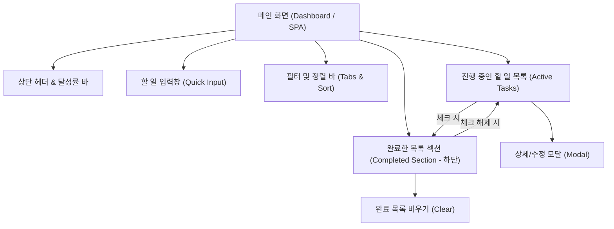

# [PRD] 할 일 목록(To-Do List) 애플리케이션 요구사항 정의서

- **작성일**: 2026-10-30
- **상태**: Draft (검토 대기 - 완료 목록 하단 분리 요구사항 반영)
- **문서 버전**: v1.1

---

## 1. 무엇을 만드는가 (Product Overview)

### 1.1 제품 정의
사용자가 일상 업무, 학업, 개인 목표를 놓치지 않고 체계적으로 기록하고 관리할 수 있는 **직관적이고 가벼운 반응형 웹 기반 할 일 관리(To-Do List) 애플리케이션**입니다.

### 1.2 핵심 가치 및 목표
- **간결성(Simplicity)**: 복잡한 설정 없이 3초 안에 할 일을 등록하고 확인할 수 있는 간결한 사용성
- **가시성(Visibility)**: 우선순위, 마감일(D-day), 진행률을 한눈에 파악할 수 있는 시각적 피드백 제공
- **정리 및 회고 편의성(Archive & Review)**: 완료된 일도 언제든 하단에서 쉽게 찾고 검토하거나 필요시 다시 복원할 수 있는 기능
- **지속성(Persistence)**: 새로고침이나 브라우저 재시작 후에도 데이터가 유지되는 로컬 저장(LocalStorage) 지원

---

## 2. 누가 쓰는가 (Target Audience)

### 2.1 주요 사용자군
1. **바쁜 직장인/프리랜서**
   - 오늘 하루 처리해야 할 업무(To-do)를 빠르게 정리하고, 완료된 업무를 모아보며 일일 업무 보고/회고에 활용하려는 사용자
2. **학생 및 수험생**
   - 과제 마감일, 시험 일정, 매일의 공부 목표를 체크리스트 형태로 관리하려는 사용자
3. **미니멀리스트 생산성 추구자**
   - 노션(Notion), 지라(Jira) 등 복잡하고 무거운 협업 툴 대신 직관적인 체크리스트를 선호하는 사용자

### 2.2 사용자 페르소나 예시
> **김민수 (29세, 프론트엔드 개발자)**
> - *"오늘 할 일을 빠르게 적어두고 완료 처리하되, 이전에 완료한 일들도 사라지지 않고 화면 하단에 깔끔하게 모여 있어 하루를 마칠 때 무엇을 끝냈는지 한눈에 찾아보고 싶습니다."*

---

## 3. 어떤 기능이 있는가 (Feature Specifications)

### 3.1 핵심 필수 기능 (MVP - Phase 1)

| 구분 | 기능명 | 설명 | 우선순위 |
| :--- | :--- | :--- | :---: |
| **할 일 등록** | 빠른 추가 (Quick Add) | 텍스트 입력 후 `Enter` 키로 즉시 추가 (제목, 마감일, 우선순위 선택 가능) | P0 (필수) |
| **할 일 조회** | 목록 렌더링 | 등록된 할 일 카드 표시 (완료 여부, 마감일, 우선순위 뱃지) | P0 (필수) |
| **상태 관리** | 완료 체크 & 복원 | 체크 시 완료 상태 전환, 체크 해제 시 '진행 중'으로 즉시 복원 | P0 (필수) |
| **완료 목록 분리**| 완료한 목록 하단 조회 | 체크된 항목은 취소선과 함께 하단의 **'완료한 목록(Completed Section)'**에 모여 언제든 조회 가능 (접기/펼치기 토글) | P0 (필수) |
| **할 일 수정** | 인라인/모달 수정 | 기존 할 일의 제목, 우선순위, 마감일 변경 | P0 (필수) |
| **할 일 삭제** | 단일/일괄 삭제 | 개별 삭제 버튼 및 "완료된 항목 모두 비우기(Clear Completed)" 기능 | P0 (필수) |
| **필터링** | 상태 필터 | `전체(All)` / `진행 중(Active)` / `완료(Completed)` 탭 필터 | P0 (필수) |
| **데이터 저장** | 로컬 저장소 연동 | 브라우저 `localStorage`를 통한 데이터 영구 보관 (새로고침 대응) | P0 (필수) |

### 3.2 사용자 경험 강화 기능 (Phase 2)

| 구분 | 기능명 | 설명 | 우선순위 |
| :--- | :--- | :--- | :---: |
| **우선순위** | 3단계 중요도 | `높음(High)` / `보통(Medium)` / `낮음(Low)` 색상 태그 부여 | P1 (권장) |
| **마감일/D-Day** | 마감 알림 뱃지 | 오늘 마감, D-day, 기한 지남(Overdue) 시각적 경고 | P1 (권장) |
| **카테고리/태그** | 분류 관리 | 업무, 개인, 공부 등 카테고리 라벨링 및 태그 필터링 | P1 (권장) |
| **정렬/검색** | 검색 및 정렬 옵션 | 키워드 검색, 마감일순/생성순/우선순위순 정렬 | P1 (권장) |
| **진행 현황** | 프로그레스 바 | 오늘 완료율(예: 3/5 완료, 60%) 상단 그래프 표시 | P1 (권장) |
| **테마 모드** | 3색 감성 테마 | `라이트(Light)` / `다크(Dark)` / `세피아 웜(Sepia Eye-Care)` 3단계 테마 전환 | P1 (지원) |

---

## 4. 화면은 몇 개인가 (Screen Structure & Flow)

사용자가 번거롭게 페이지를 이동하지 않도록 **단일 페이지 애플리케이션(SPA, 1개 메인 화면 + 1개 팝업 모달)** 구조를 채택하며, 메인 화면 내에서 **진행 중인 목록과 완료된 목록을 상하로 명확히 분리**합니다.

### 4.1 화면 목록 (총 1개 화면 + 1개 보조 모달)

#### [화면 1] 메인 대시보드 화면 (Main View - Single Page)
- **헤더 영역 (Header)**
  - 서비스 타이틀 (예: *My To-Do*)
  - 오늘 날짜 (예: *2026년 10월 30일*)
  - 오늘의 달성률 프로그레스 바 (예: *5개 중 3개 완료 - 60%*)
- **입력 폼 영역 (Input Form)**
  - 태스크 제목 입력 인풋 (Placeholder: *"할 일을 입력하고 Enter를 누르세요"*)
  - 세부 옵션: 우선순위 선택(상/중/하), 마감일자(Date Picker), 카테고리 태그
  - '추가(+)' 버튼
- **필터 및 정렬 툴바 (Control Bar)**
  - 상태 탭: `전체` | `진행 중` | `완료`
  - 정렬 드롭다운: 마감일순, 등록순, 중요도순
- **할 일 목록 영역 (Task List Container)**
  1. **진행 중인 할 일 (Active Tasks)**
     - 아직 완료되지 않은 항목 목록
     - 체크박스 클릭 시 애니메이션과 함께 하단 '완료한 목록'으로 이동
     - 제목, 마감일(D-day), 중요도 뱃지, 수정/삭제 버튼
  2. **완료한 목록 (Completed Tasks Section - 하단 분리 영역)**
     - 접기/펼치기(Accordion) 토글 지원 (예: `▼ 완료된 일 (3)`)
     - 취소선 및 완료 시간 표기
     - **체크박스를 다시 클릭하면 즉시 '진행 중' 목록으로 원복(복원)**
     - 개별 영구 삭제 및 "완료된 항목 모두 비우기" 버튼
- **푸터 영역 (Footer Actions)**
  - 남은 할 일 개수 카운터 (*"2 tasks left"*)

#### [보조 화면 1-A] 상세 및 수정 모달 (Edit Modal / Drawer)
- 기존 할 일의 제목, 메모, 마감일, 우선순위, 태그를 편집하고 저장할 수 있는 팝업 모달.

---

## 5. 권장 기술 스택 및 구현 단계

- **Frontend**: HTML5, CSS3 / TailwindCSS, Vanilla JS 또는 React / Vite
- **Storage**: 브라우저 `localStorage` (초기 백엔드 서버 없이 즉시 브라우저에서 실행 가능)
- **배포/실행**: 정적 웹 호스팅 또는 로컬 브라우저 즉시 구동
